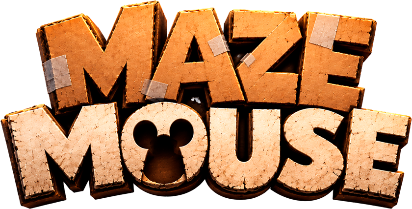

# Maze Mouse

Prototipo de juego HTML: sos un ratoncito de laboratorio que tiene que escapar de un laberinto de cartón completamente a oscuras, con una linterna atada al lomo que apunta hacia adelante.

- Vista cenital: la cámara sigue al ratón.
- Oscuridad total: solo se ve lo que ilumina la linterna, y las paredes cortan el haz.
- Tiempo límite por nivel: si se acaba, repetís el mismo laberinto.
- En los últimos 10 segundos suena la sirena: todo se tiñe de rojo y un haz giratorio deja ver más allá de la linterna; cada vez que el haz pasa por encima de la rata suena un "Uuuuh".

## Modos

- **Historia:** 40 niveles diseñados (siempre iguales). Se guardan los niveles desbloqueados, las estrellas (1 a 3) y tu mejor tiempo de cada nivel. Cada meta suma una estrella: una por escapar, una por juntar los quesos del objetivo y una por escapar en el tiempo objetivo o antes. El cartel de inicio te muestra el objetivo (quesos y tiempo) y al terminar ves tus estrellas, tu tiempo, si fue récord y las monedas que juntaste. Hay pocas monedas por nivel (unas 6 a 9): un par sueltas en el camino directo y un tesorito de 3 a 5 en algún desvío o callejón, que rinde pero cuesta tiempo. Las mecánicas aparecen de a una y después se combinan, con laberintos cada vez más grandes:
  - **1:** escapar a tiempo. **2–3:** quesos. **4–5:** pegote. **6–7:** trampas. **8–9:** puertas de un solo sentido. **10–11:** molinetes. **12–13:** compuertas que se abren y se cierran.
  - **14–40:** todo combinado, con laberintos cada vez más grandes. Desde el nivel 2 todos los niveles tienen al menos un queso.
- **Luz y oscuridad (Historia):** en la mayoría de los niveles la luz del laberinto está prendida: se ve todo, el reloj corre libre y no se pierde por tiempo. Unos pocos (el 30%) son a oscuras: la linterna tiene una pila de 60 segundos, que se ve abajo del queso en 4 bloques de 15, y en el laberinto hay pilas que la vuelven a llenar. Si se termina la pila, perdés. Con la luz prendida la rata va sin arnés ni linterna.
- **Desafío:** laberintos al azar, infinitos, cada vez más grandes y con la cámara más cerca.
- **Monedas y ratitas:** juntá monedas en los laberintos (se guardan aunque pierdas). En **Desafío** el nivel N tiene N monedas: sirve para juntar, y rinde llegar más lejos. En la **Máquina** cada giro cuesta 20 monedas (por ahora es gratis, para probarla) y te da una ratita según su rareza: 10 comunes, 6 infrecuentes, 3 raras y 1 legendaria, la Dorada (si sale repetida, te devuelve la mitad). Para verlas todas juntas: `index.html?ratas`. En el **Bioterio** elegís con cuál jugar.

## Jugar

**Online:** https://pabloforconi.github.io/raton-laberinto/

O abrí `index.html` en el navegador. No necesita instalación ni servidor.

| Tecla | Acción |
|---|---|
| 1 / 2 (en la portada) | Historia / Desafío |
| ↑ ↓ ← → / W A S D | moverte en esa dirección (el ratón gira hacia donde apuntás; se pueden combinar para diagonales) |
| P / Esc | pausa |
| Q (en pausa) | salir al menú |
| M | música (on/off) |
| F | efectos de sonido (on/off) |
| R | reiniciar nivel |
| N | saltar nivel (debug) |

En el celular: apoyás el dedo en cualquier lugar y aparece un joystick; el ratón gira hacia donde apuntás y avanza según cuánto empujás. Los botones de pausa, música y efectos están arriba a la derecha, y la casita (volver al menú) arriba a la izquierda.

La música (`audio/laberinto-de-circuitos.mp3`) arranca con el primer toque o tecla y suena bajita para no tapar los efectos.

Los parámetros ajustables (velocidad, linterna, tamaños de nivel, zoom y tiempo) están al principio del script en `index.html`. Los niveles de Historia se definen en la tabla `LEVELS` (tamaño, semilla y cantidad de cada mecánica).

`concept/` tiene el arte conceptual de referencia.
